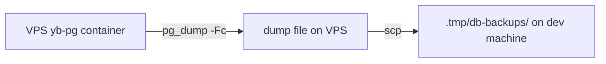

# idclear VPS database backup

## Purpose

Runbook for pulling a Postgres dump from the **testing VPS** (`testing.idclear.com`)
down to the local repo's gitignored `.tmp/` scratch directory. Covers SSH,
`pg_dump` inside the `yb-pg` container, `scp` back to the dev machine, and
verification.

## When to use

- Before a risky migration, deploy, or schema change on the testing VPS
- User asks to "back up the VPS database", "snapshot the DB", "pull a dump
  from testing", or similar
- Investigating a bug and want a local copy of VPS data to query offline

## When NOT to use

| Target | Use instead |
|--------|-------------|
| Local dev Postgres | `pg_dump` directly against the local `yb-pg` container — no SSH needed |
| Full VPS deploy/rollback | [idclear-vps-testing-deploy](../idclear-vps-testing-deploy/SKILL.md) |
| Restoring a backup onto a server | Not covered here — restoring is destructive; confirm target and take a pre-restore backup first |
| production / staging.idclear.com | Not this VPS; see infra/terraform and team runbooks |

## Environment map

| Item | Value |
|------|-------|
| Host | `212.227.30.157` |
| SSH user | `targ` |
| Repo path (VPS) | `~/idclear/monorepo` |
| DB container | `yb-pg` |
| DB port (in container) | `5433` |
| DB user | `postgres` |
| Databases | `test_nextjs_payload` (app data), `risk` (may be empty), `postgres` (admin) |
| Local destination | `.tmp/db-backups/` (gitignored — see `AGENTS.md` Conventions) |



All commands run from the **developer machine**, wrapped with `devenv shell --`
per repo shell rules.

## Prerequisites

1. SSH key access to `targ@212.227.30.157` works
   (`ssh -o BatchMode=yes targ@212.227.30.157 true`).
2. `.tmp/db-backups/` exists locally (create it if missing — it's covered by
   the repo-root `.tmp/` gitignore entry, no extra ignore rule needed).

## Standard backup workflow

### 1. Dump the database inside the VPS container

Pick the database (default `test_nextjs_payload`). Use `-Fc` (custom format,
compressed, restorable with `pg_restore`) rather than plain SQL:

```bash
devenv shell -- ssh targ@212.227.30.157 \
  'cd ~/idclear/monorepo && docker compose exec -T yb-pg \
    pg_dump -h localhost -p 5433 -U postgres -Fc -d test_nextjs_payload \
    -f /tmp/test_nextjs_payload_$(date +%Y%m%d_%H%M%S).dump'
```

The dump file was written **inside the `yb-pg` container's `/tmp`**, not on
the VPS host filesystem — `docker compose exec` runs `pg_dump` in the
container's namespace. List it with a shell inside the container (a bare
`ls /tmp/*.dump` glob is expanded by the *outer* SSH shell on the host,
which has no match, and fails with "No such file or directory"):

```bash
devenv shell -- ssh targ@212.227.30.157 \
  "cd ~/idclear/monorepo && docker compose exec -T yb-pg sh -c 'ls -t /tmp/*.dump | head -1'"
```

### 2. Copy the dump out of the container onto the VPS host

`scp` can only reach the VPS host filesystem, not the container's — copy it
out first with `docker compose cp`:

```bash
devenv shell -- ssh targ@212.227.30.157 \
  "cd ~/idclear/monorepo && docker compose cp yb-pg:'<path from step 1>' '<path from step 1>'"
```

### 3. Copy the dump back to the local repo

```bash
mkdir -p .tmp/db-backups
devenv shell -- scp targ@212.227.30.157:'<path from step 1>' .tmp/db-backups/
```

### 4. Clean up the remote temp file

Dumps left in `/tmp` on the VPS (both the container copy and the host copy
made in step 2) are not tracked or rotated — remove both once the local
copy is confirmed:

```bash
devenv shell -- ssh targ@212.227.30.157 \
  "cd ~/idclear/monorepo && docker compose exec -T yb-pg rm -f '<path from step 1>' && rm -f '<path from step 1>'"
```

## Verification

Confirm the local file is non-empty and a valid custom-format dump:

```bash
ls -lh .tmp/db-backups/
devenv shell -- pg_restore --list .tmp/db-backups/<file>.dump | head -20
```

`pg_restore --list` prints the table-of-contents without touching any
database — a clean listing (no "input file does not appear to be a valid
archive" error) confirms the dump is usable.

## Other databases

Swap `-d test_nextjs_payload` for `-d risk` or `-d postgres` (or add
`--globals-only` via `pg_dumpall -g` for roles) as needed. Do not use `idcl`
as a database name — see [idclear-vps-testing-deploy/reference.md](../idclear-vps-testing-deploy/reference.md#database),
it is not a real database on this host.

To back up every app database in one pass:

```bash
devenv shell -- ssh targ@212.227.30.157 \
  'cd ~/idclear/monorepo && for db in test_nextjs_payload risk; do
     docker compose exec -T yb-pg pg_dump -h localhost -p 5433 -U postgres -Fc -d "$db" \
       -f "/tmp/${db}_$(date +%Y%m%d_%H%M%S).dump"
   done'
devenv shell -- ssh targ@212.227.30.157 'ls -t /tmp/*.dump | head -2'
```

Then `scp` each path back as in Step 2.

## Failure modes

| Symptom | Likely cause | Fix |
|---------|--------------|-----|
| `pg_dump: error: connection to server ... failed` | Wrong port or `yb-pg` not running | `docker compose ps yb-pg` — confirm the container is up, port is `5433` not `5432` |
| `scp` fails with "No such file or directory" | Used the wrong/stale timestamp path | Re-run the `ls -t /tmp/*.dump \| head -1` lookup right before `scp` |
| Local `.tmp/db-backups/` file is 0 bytes | `pg_dump` failed mid-run (disk full, wrong db name) | Check remote disk space (`df -h`) and confirm the database name against the table above |
| `pg_restore --list` errors "not an archive" | Dumped with plain SQL (`-Fp`) but treated as custom format, or scp truncated the file | Always use `-Fc`; re-run `scp` and compare file size to the remote copy |

## Core rules

1. **Never restore onto the VPS from this skill** — dumping only. Restoring
   is destructive and needs an explicit, separate, confirmed step.
2. **Destination is always `.tmp/db-backups/`** — gitignored, never commit
   a dump.
3. **Shell:** Wrap local commands with `devenv shell --`; SSH/docker compose
   commands run on the VPS inside quoted remote commands.
4. **Secrets:** Dumps can contain PII/customer data — never paste dump
   contents into chat, and delete remote `/tmp` copies after transfer.
5. **Verify:** Always check local file size and `pg_restore --list` before
   considering the backup done.

## See also

- [idclear-vps-testing-deploy](../idclear-vps-testing-deploy/SKILL.md) — deploy runbook this skill was copied from
- [idclear-vps-testing-deploy/reference.md](../idclear-vps-testing-deploy/reference.md#database) — database names and psql examples
- `AGENTS.md` — Conventions: `.tmp/` is the only allowed scratch location
